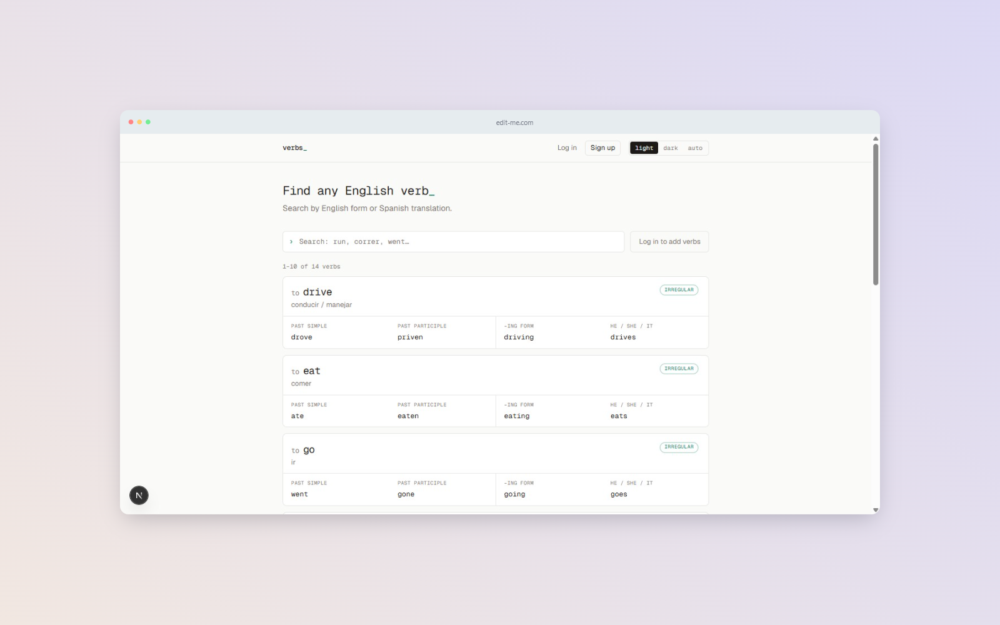

# 🔤 Verb Conjugator v2

> Search English verbs by any form or by their Spanish translation. A full-stack app with authentication, role-based permissions, and a tested API.

[](https://github.com/MarcoRosselDev/english-verbs-v2/actions/workflows/ci.yml)


**🌐 Live demo:** <https://YOUR-APP.vercel.app>
**🎯 Recruiters:** click **"Try the demo account"** on the login page. No sign-up needed.



---

## 📖 About

This is the second iteration of [English-verbs](https://github.com/MarcoRosselDev/English-verbs), a tool I built because I was tired of jumping between tabs to check verb conjugations while studying English.

**v1** was a React + FastAPI app with a public CRUD: anyone could create or delete data. **v2** rebuilds it on Next.js and focuses on what a real application needs: **authentication, authorization, input validation, automated tests, and CI**.

## ✨ Features

- 🔍 **Search** by any English form (infinitive, past, participle, -ing, third person) or by Spanish translation, ranked by relevance (exact match → prefix → partial).
- 🃏 **Cards** with each tense clearly separated, regular/irregular badge, and edit/delete actions revealed on hover or keyboard focus.
- 🔐 **Authentication:** sign up, log in, log out, plus a one-click demo account.
- 🛡️ **Role-based permissions:** visitors read, users manage their own verbs, admins manage everything.
- 🌓 **Light / dark / system theme**, persisted, with no flash on page load.
- 📱 **Responsive** layout, with explicit loading, empty, and error states.
- ♿ **Accessibility basics:** native `<dialog>` (focus trap, `Esc`), ARIA attributes, visible focus, reduced-motion support.

## 🛡️ Permissions

| Who | Can |
|---|---|
| Visitor | Search and view verbs |
| User (including the demo account) | Create verbs (max 25) and edit or delete **only their own** |
| Admin | Everything, including the seed verbs |

The rule lives in a single pure function (`canModifyVerb`) used by both the server (enforcement) and the UI (showing or hiding buttons). **The UI only hides; the server decides**: every protected route re-checks permissions.

## 🛠️ Tech stack

| Layer | Technology |
|---|---|
| Framework | Next.js 16 (App Router, Route Handlers), React 19 |
| Language | TypeScript (strict) |
| Styling | Tailwind CSS v4 with CSS-variable design tokens |
| Database | PostgreSQL on Neon, **raw SQL (no ORM)** via `@neondatabase/serverless` |
| Validation | Zod, one schema shared by client, server, and types |
| Auth | `jose` (JWT) + `bcryptjs`, session in an `httpOnly` cookie |
| Testing | Vitest |
| CI / Hosting | GitHub Actions · Vercel |

## 🏗️ Architecture

```
┌──────────────────────────────────────────────────────────────┐
│ Browser                                                      │
└───────────────┬──────────────────────────────────────────────┘
                │ HTTPS (session in httpOnly cookie)
                ▼
┌──────────────────────────────────────────────────────────────┐
│ Next.js on Vercel                                            │
│                                                              │
│  proxy.ts ........ first gate: /account requires a session   │
│  Pages ........... Server Components resolve the user        │
│  /api/auth/*  .... register · login · logout · demo          │
│  /api/verbs/* .... list/search · create · read · update · delete │
│                                                              │
│  lib/permissions.ts   one rule, used by API and UI           │
│  lib/verbs.ts         the only layer that writes verb SQL    │
│  lib/users.ts         the only layer that touches user rows  │
└───────────────┬──────────────────────────────────────────────┘
                │ parameterized SQL
                ▼
┌──────────────────────────────────────────────────────────────┐
│ PostgreSQL (Neon): users · verbs · favorites                 │
│ pg_trgm GIN indexes for substring search                     │
└──────────────────────────────────────────────────────────────┘
```

## 🔒 Security decisions

- **Passwords:** hashed with bcrypt (cost 12). Plain text is never stored or logged.
- **Sessions:** signed JWT (HS256, 7 days) in a cookie that is `httpOnly`, `SameSite=Lax`, and `Secure` in production. JavaScript can't read it (XSS), and other sites can't trigger authenticated POSTs (CSRF).
- **The user is re-read from the database on every request**, so deleting a user or changing a role takes effect immediately instead of waiting for a token to expire.
- **No user enumeration:** login returns the same message for unknown emails and wrong passwords, and compares against a dummy hash so response time doesn't leak which emails exist.
- **No mass assignment:** the role is never read from the request body; every sign-up is a plain `user`.
- **SQL injection:** all values travel as bound parameters. LIKE wildcards (`%`, `_`) typed by the user are escaped.
- **Server-side validation** with the same Zod schemas as the forms. Pagination has a hard cap.
- **Defense in depth:** `proxy.ts` is only an optimistic first gate; every page and API route verifies the session again.
- **Errors:** database details are logged on the server and never sent to the client.

## 🔌 API

| Method | Endpoint | Access | Notes |
|---|---|---|---|
| `GET` | `/api/verbs?q=&limit=&offset=` | Public | Search and pagination (`limit` ≤ 50) |
| `GET` | `/api/verbs/:id` | Public | |
| `POST` | `/api/verbs` | Logged in | `201`, `403` over the verb limit, `409` duplicate |
| `PUT` | `/api/verbs/:id` | Owner or admin | `403` otherwise |
| `DELETE` | `/api/verbs/:id` | Owner or admin | `204` |
| `POST` | `/api/auth/register` | Public | Creates the account and starts a session |
| `POST` | `/api/auth/login` | Public | |
| `POST` | `/api/auth/logout` | Public | POST on purpose, so it can't be triggered by a cross-site link |
| `POST` | `/api/auth/demo` | Public | Logs in as the demo user (limited `user` role) |

Errors use a consistent shape: `{ "error": "message" }`, with `issues: [{ field, message }]` for validation failures.

## 🚀 Run it locally

**Requirements:** Node.js 20.9+ and a PostgreSQL database (a free [Neon](https://neon.com) project works well).

```bash
git clone https://github.com/MarcoRosselDev/english-verbs-v2.git
cd english-verbs-v2
npm install
```

Create `.env.local`:

```env
DATABASE_URL="postgresql://..."
# Generate with: node -e "console.log(require('crypto').randomBytes(32).toString('base64'))"
AUTH_SECRET="a-random-string-of-at-least-32-characters"
```

Create the schema and sample data:

```bash
psql "$DATABASE_URL" -f db/schema.sql
psql "$DATABASE_URL" -f db/seed.sql
```

Create an admin and the demo account:

```bash
node --env-file=.env.local scripts/create-user.mjs you@example.com "a-strong-password" admin
node --env-file=.env.local scripts/create-user.mjs demo@verbs.example "a-long-random-password" user
```

Start the app:

```bash
npm run dev
```

## 🧪 Tests and CI

```bash
npm test            # run once
npm run test:watch  # watch mode
npm run typecheck
npm run lint
```

The suite covers permission rules, input validation, session tokens (forged, expired, and wrong-algorithm tokens are rejected), HTTP helpers, and every verb route, including **the negative cases**: 401 without a session, 403 on someone else's verb, 409 on duplicates, and generic 500s that don't leak details. GitHub Actions runs lint, type-check, tests, and a production build on every push and pull request.

## 🗂️ Project structure

```
├── db/                 schema.sql, seed.sql
├── scripts/            create-user.mjs
├── tests/              Vitest suites
├── .github/workflows/  CI
└── src/
    ├── app/            pages and API route handlers
    ├── components/     UI components
    ├── hooks/          useDebounce
    ├── lib/            db, auth, session, permissions, verbs, users, http, api-client
    ├── types/          Zod schemas and shared types
    └── proxy.ts        route protection
```

## 🧭 Design decisions

- **Raw SQL instead of an ORM.** I wanted to be fluent in the SQL itself: relevance ordering, trigram indexes, constraints, `RETURNING`. The query layer is small, and everything is parameterized.
- **Cookie sessions instead of `localStorage`.** A token in `localStorage` can be stolen by any injected script; an `httpOnly` cookie can't be read from JavaScript.
- **Own auth instead of a library.** The surface is small, and I wanted to understand and be able to defend every piece: hashing, token signing, cookie flags, and permission checks.
- **`UNIQUE (infinitive, spanish_translation)`** instead of just the infinitive, because homographs exist (*lie* = to tell a falsehood / to recline).
- **Race-condition-safe search.** Requests are debounced (300 ms) and cancelled with `AbortController`, so a slow stale response can't overwrite a newer one.
- **One validation schema** is the source of truth for the form, the API, and the TypeScript types (`z.infer`).

## ⚠️ Known limitations

- No rate limiting on login attempts yet.
- No email verification or password reset.
- The demo account is shared, so visitors see each other's demo verbs (cleaned up periodically).
- Tests mock the database, so the SQL itself (e.g. ranking order) isn't covered by automated tests. Integration tests against a real Postgres are on the roadmap.
- Search is accent-sensitive (`unaccent` extension would fix it).

## 🛣️ Roadmap

- [ ] Rate limiting for login
- [ ] Favorites (the table already exists)
- [ ] Integration tests against a real PostgreSQL in CI
- [ ] End-to-end tests with Playwright
- [ ] Accent-insensitive search
- [ ] Docker Compose for local development

## 👤 Author

**Marco Rossel**

- GitHub: [@MarcoRosselDev](https://github.com/MarcoRosselDev)
- LinkedIn: [Marco Rossel](https://www.linkedin.com/in/marco-rossel-378b85256/)
- Email: andresmarcorossel@gmail.com

## 📄 License

MIT. See [LICENSE](LICENSE).